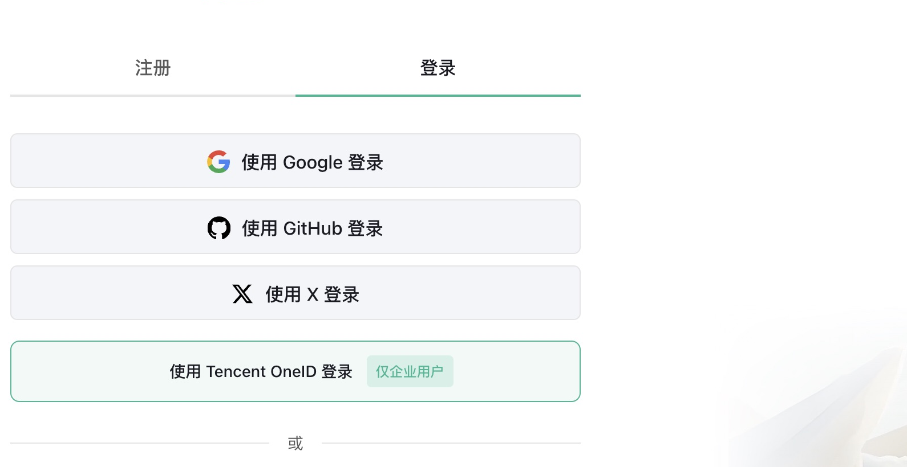

# 常用小工具

这里收集我平时自用并持续整理的一些小工具，用来让常用网站更顺手，也把游戏和日常使用中的信息整理得更清楚。

这些工具都是个人维护的，与对应网站或公司没有官方关联。

## WorkBuddy 国际版：恢复第三方登录

WorkBuddy 国际版（`workbuddy.ai`）的登录页有时会把 Google、GitHub 和 X 登录入口藏起来。这个工具会把页面原本已有的按钮重新显示出来，不会创建账号，也不会替你登录。

[安装脚本](https://raw.githubusercontent.com/iamvicliu/Script/main/Tampermonkey/WorkBuddy-restore-third-party-login/WorkBuddy-restore-third-party-login.user.js) · [查看说明](Tampermonkey/WorkBuddy-restore-third-party-login/WorkBuddy-restore-third-party-login.greasyfork.md)

## 游戏页面整理

- 《流放之路 2》：把 poe.ninja 和 WeGame 的公开 BD 页面整理成方便查看、复制和对照的名称与技能表格。
- 《暗黑破坏神 4》：为暗黑核 BD 页面增加全屏浏览和模块切换，减少反复退出全屏。
- PoEDB / POE2DB：提供多语言名称显示、搜索和复制。

## 日常网页与网络

- 一些常用网页的小幅显示调整。
- Loon 使用的个人分流规则。
- 新服务器常用的基础环境初始化说明。

## 使用提醒

- 使用前先阅读对应目录中的说明。
- 网页改版后，部分工具可能需要跟着更新。
- 工具不会替你保存密码、验证码或登录凭证。
