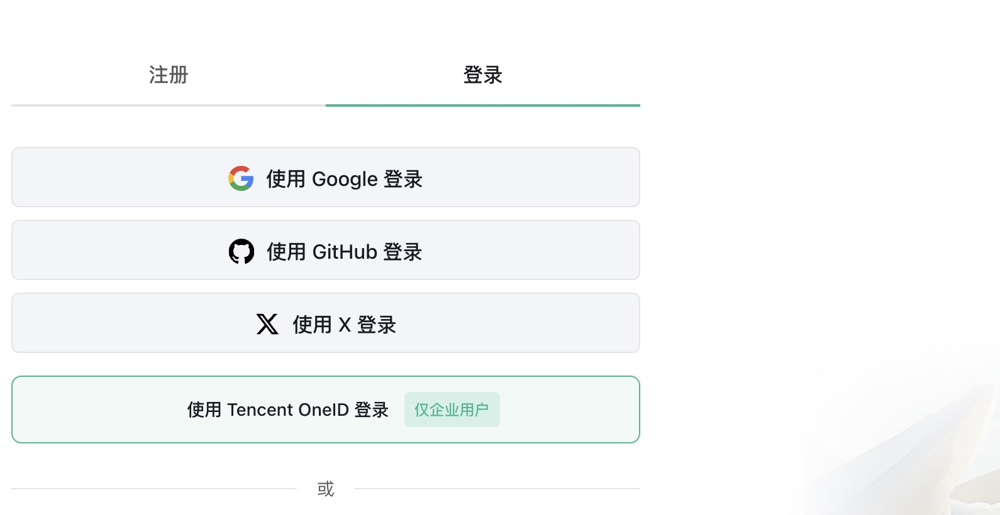

# WorkBuddy 国际版：恢复第三方登录

WorkBuddy 国际版（`workbuddy.ai`）的登录页有时只显示企业账号和邮箱，原本存在的 Google、GitHub 和 X 登录按钮会被藏起来。这个小工具会把页面里已经有的登录按钮重新显示出来。

它不会创建账号，不会替你登录，也不会修改账号设置。

## 安装与使用

1. **安装脚本管理器**：先在浏览器安装 Tampermonkey（油猴）等用户脚本管理器。
2. **一键安装**：[点击安装 WorkBuddy 恢复第三方登录](https://raw.githubusercontent.com/iamvicliu/Script/main/Tampermonkey/WorkBuddy-restore-third-party-login/WorkBuddy-restore-third-party-login.user.js)。
3. **打开登录页**：访问或刷新 WorkBuddy 登录页，登录区域就会恢复显示 Google、GitHub 和 X 按钮（页面实际支持哪些按钮就显示哪些）。
4. **选择登录方式**：点击你平时使用的登录方式即可。

## 说明与免责声明

- **纯页面显示调整**：脚本只恢复显示页面上已有的按钮，不读取或保存密码、Cookie、验证码和登录凭证，也不会自动点击登录或替你同意任何服务条款。
- **兼容性提示**：能否完成登录仍由 WorkBuddy 与对应第三方账号服务决定；若页面后续改版导致按钮位置或结构变化，脚本可能需要同步更新。
- **开源许可**：个人维护的页面显示辅助工具，以 MIT 协议开源，与 WorkBuddy 官方无关联。
